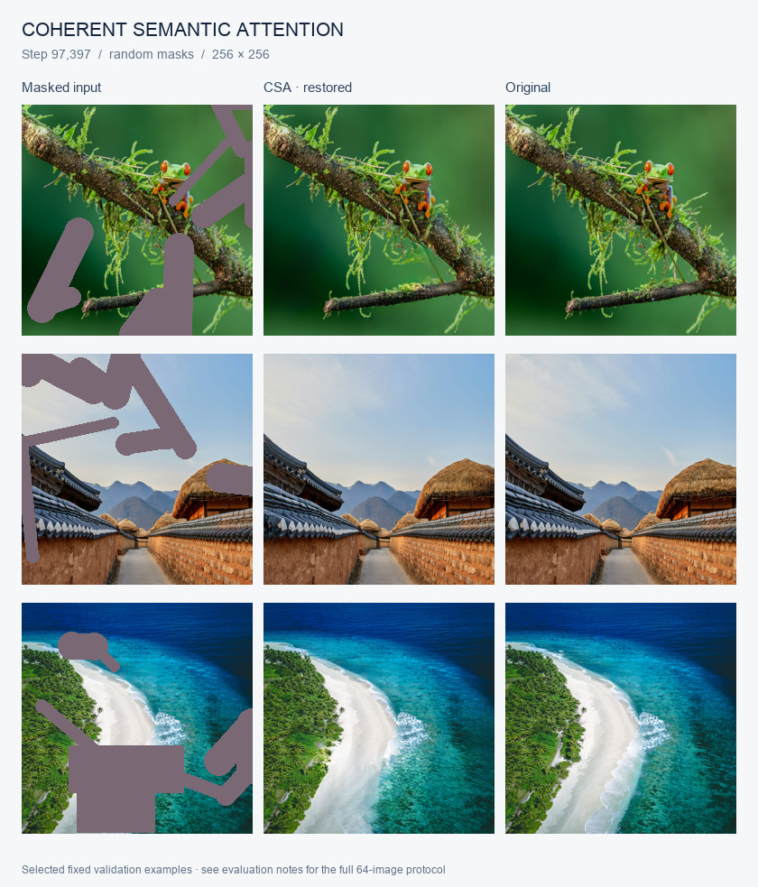
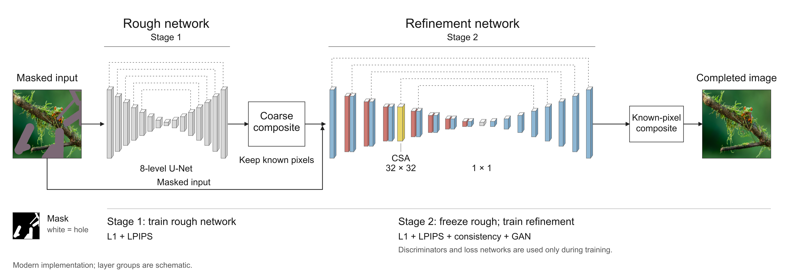
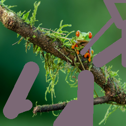
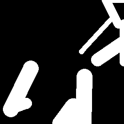

<div align="center">

<p><strong>ICCV 2019 · Modern PyTorch implementation</strong></p>

<h1>Coherent Semantic Attention for Image Inpainting</h1>

<p>Recover missing image regions with a rough prediction and context-aware refinement.</p>

<p><strong>Hongyu Liu · Bin Jiang · Yi Xiao · Chao Yang</strong></p>

<p>
  <a href="https://openaccess.thecvf.com/content_ICCV_2019/html/Liu_Coherent_Semantic_Attention_for_Image_Inpainting_ICCV_2019_paper.html">Paper</a> ·
  <a href="#how-it-works">Method</a> ·
  <a href="#try-the-checkpoint">Quickstart</a> ·
  <a href="https://huggingface.co/KumaPower/CSA">Hugging Face</a> ·
  <a href="docs/TRAINING.md">Training</a> ·
  <a href="docs/DATASETS.md">Datasets</a>
</p>



<p><sub>Actual inference from the modern stage-2 checkpoint at step 97,397. Columns: masked input · restored · original.<br>
Selected examples; <a href="docs/assets/csa-step97397-full.jpg">view all eight preview cases, including failures</a>.</sub></p>

</div>

The author's PyTorch implementation of **Coherent Semantic Attention (CSA)**, with separate training stages, random masks, and a ready-to-use checkpoint. The modern release uses **L1 + LPIPS** and the original **image and feature PatchGANs**.

This branch updates the 2019 implementation and training recipe. See [what changed](docs/MIGRATION.md) and the [checkpoint card](docs/releases/step97397/README.md) for its relationship to the paper.

## How it works

<p align="center">
  
</p>

**Train rough prediction first, then freeze it and train refinement.** CSA operates on 32 × 32 encoder features at the 256 × 256 training resolution. The diagram follows the visual layout of Figure 2 in the paper and shows the modern training recipe. [Editable SVG](docs/assets/csa-pipeline-paper.svg).

## Try the checkpoint

### 1. Install

**Verified Linux/NVIDIA environment:** Python 3.10.14 · PyTorch 2.6.0 · torchvision 0.21.0 · CUDA 12.4. The [official wheel pairing](https://pytorch.org/get-started/previous-versions/#v260) below requires a compatible NVIDIA driver, with no separate CUDA toolkit installation. For CPU, macOS, and other CUDA builds, see [installation and devices](docs/USAGE.md#installation-and-devices).

```bash
git clone --branch master https://github.com/KumapowerLIU/CSA-inpainting.git
cd CSA-inpainting
python3.10 -m venv .venv
source .venv/bin/activate
python -m pip install --upgrade pip
python -m pip install torch==2.6.0 torchvision==0.21.0 \
  --index-url https://download.pytorch.org/whl/cu124
python -m pip install -e .
python - <<'PY'
import torch, torchvision
assert torch.cuda.is_available(), "CUDA is unavailable"
print(torch.__version__, torchvision.__version__)
PY
```

### 2. Download and run

The **528.5 MB** [Hugging Face checkpoint](https://huggingface.co/KumaPower/CSA) contains both generators. Inference needs no discriminator, VGG, or LPIPS weights.

```bash
mkdir -p checkpoints
curl -fL https://huggingface.co/KumaPower/CSA/resolve/main/csa-stage2-step97397.pt \
  -o checkpoints/csa-stage2-step97397.pt

csa infer \
  --checkpoint checkpoints/csa-stage2-step97397.pt \
  --image examples/masked.png \
  --mask examples/mask.png \
  --output outputs/restored.png \
  --device auto
```

### 3. Supply your image and mask

<table>
  <tr>
    <th align="center">Input image</th>
    <th align="center">Mask</th>
    <th align="center">CSA output</th>
  </tr>
  <tr>
    <td></td>
    <td></td>
    <td></td>
  </tr>
</table>

**White = fill; black = keep.** Use an image and mask with matching dimensions. The example above is the checkpoint's actual output; an intact input image also works because the CLI masks it internally.

The model was trained at **256 × 256**. Other sizes are padded and cropped, but their restoration quality has not been validated. `--device auto` selects CUDA, then MPS, then CPU. See [usage](docs/USAGE.md) for custom inputs and folder evaluation.

## Train and extend

Follow the [two-stage training guide](docs/TRAINING.md) for complete commands, checkpoint selection, and resume:

1. Install the training extra with `python -m pip install -e '.[perceptual]'` on a CUDA machine.
2. Put complete RGB images in separate train/validation folders, then follow the [runtime and index preparation](docs/TRAINING.md#prepare-independent-runtimes).
3. Run [stage 1](docs/TRAINING.md#stage-1-rough-reconstruction), select its checkpoint on held-out images, then run [stage 2](docs/TRAINING.md#stage-2-csa-refinement) with that frozen parent.

| Objective | Fresh-training recipe |
|---|---|
| Stage 1 | `0.1 × L1 + 1 × LPIPS` |
| Stage 2 | `0.1 × L1 + 1 × LPIPS + 0.01 × consistency + 0.002 × (image GAN + feature GAN)` |

Stage 2 uses the original PatchGAN architectures with random initialization and RaLSGAN losses. Random rectangles, strokes, or their union cover **10–40%** of each image; masks are generated online.

### Training hardware and batch size

| Setting | Stage 1 LPIPS phase | Stage 2 refinement |
|---|---|---|
| GPU / VRAM capacity | 1 × NVIDIA H100 80GB HBM3 | 1 × NVIDIA H100 80GB HBM3 |
| Optimizer batch size | 256 | 192 |
| Precision | BF16 mixed precision | BF16 mixed precision |
| Image resolution | 256 × 256 | 256 × 256 |
| LPIPS activation chunk | 8 images | 8 images |
| Observed PyTorch peak allocated / reserved | 9.15 / 12.08 GiB, training snapshot | 31.18 / 34.42 GiB, two-update probe |

**80 GB is card capacity; the last row is measured usage.** LPIPS chunking is separate from optimizer batch size. Start with the guide's batch-8 example and [memory probe](docs/TRAINING.md#released-run-versus-a-fresh-experiment) on your hardware.

### Training data and where to find it

| Dataset | Used in this release | Official source |
|---|---|---|
| Unsplash-derived photographs | 296,145 training records; 2,000 held-out records | [Unsplash Dataset](https://unsplash.com/data) · [access and schema](https://github.com/unsplash/datasets) |
| Places365-Standard | 901,730 images: a fixed random half of the 1,803,460-image training archive | [Download page](http://places2.csail.mit.edu/download.html) · [CSAIL repository](https://github.com/CSAILVision/places365) |
| HDTF talking-head frames | Added during stage 2: 30,128 selected frames, repeated into 299,469 sampling entries | [HDTF data and preprocessing](https://github.com/MRzzm/HDTF) |

The base mixture has **1,197,875 entries**; adding faces brings stage 2 to **1,497,344 sampling entries**, approximately 20% faces. Repeated entries are not unique images. The exact local splits are not distributed; see [dataset preparation and provenance](docs/DATASETS.md) to use the public sources or your own images.

## Documentation

The older `csa train` command uses a separate joint-training loop. For this release's sequential workflow, use [Training](docs/TRAINING.md).

| Guide | Contents |
|---|---|
| [Usage](docs/USAGE.md) | Installation, masks, inference, evaluation, smoke checks |
| [Training](docs/TRAINING.md) | Stage 1 → stage 2, indexed datasets, objectives, resume |
| [Datasets](docs/DATASETS.md) | Data sources, official access links, mixture and split details |
| [Checkpoints](docs/CHECKPOINTS.md) | Portable export, full training states, compatibility |
| [Migration](docs/MIGRATION.md) | Original-code audit, preserved structure, deliberate differences |
| [Design](docs/DESIGN.md) | Package layout and engineering decisions |

## Paper, history, and license

The original ICCV 2019 implementation is preserved on the [`codex/legacy-master` branch](https://github.com/KumapowerLIU/CSA-inpainting/tree/codex/legacy-master) and in [`legacy/`](legacy/).

```bibtex
@InProceedings{Liu_2019_ICCV,
  author    = {Liu, Hongyu and Jiang, Bin and Xiao, Yi and Yang, Chao},
  title     = {Coherent Semantic Attention for Image Inpainting},
  booktitle = {Proceedings of the IEEE/CVF International Conference on Computer Vision},
  month     = {October},
  year      = {2019}
}
```

The repository retains its [CC BY-NC 4.0 / noncommercial research-use notice](LICENSE.md). Third-party components and datasets retain their respective terms.
