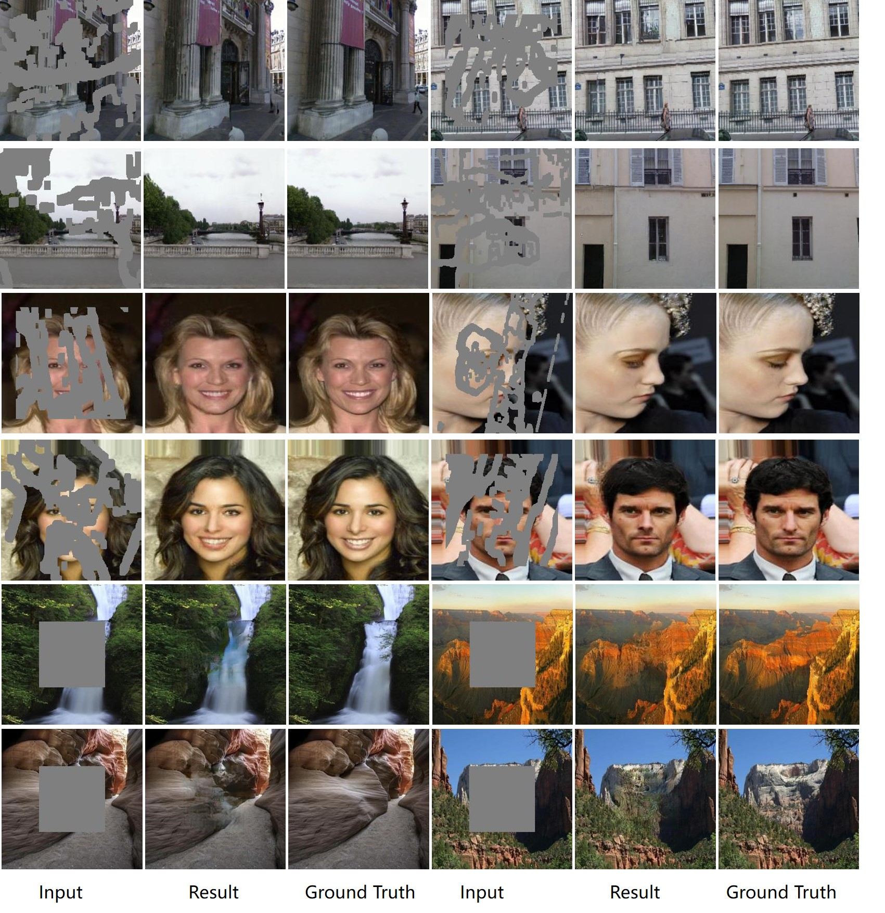

<div align="center">

# CSA Inpainting

### Coherent Semantic Attention for Image Inpainting

**ICCV 2019 · A modern PyTorch reimplementation**

Hongyu Liu · Bin Jiang · Yi Xiao · Chao Yang

[](https://openaccess.thecvf.com/content_ICCV_2019/html/Liu_Coherent_Semantic_Attention_for_Image_Inpainting_ICCV_2019_paper.html)
[](pyproject.toml)
[](pyproject.toml)
[](LICENSE.md)

[Paper](https://openaccess.thecvf.com/content_ICCV_2019/html/Liu_Coherent_Semantic_Attention_for_Image_Inpainting_ICCV_2019_paper.html)
&nbsp; / &nbsp;
[Original implementation](https://github.com/KumapowerLIU/CSA-inpainting)
&nbsp; / &nbsp;
[中文使用指南](docs/USAGE.md)
&nbsp; / &nbsp;
[Implementation notes](docs/MIGRATION.md)
&nbsp; / &nbsp;
[Validation](docs/VALIDATION.md)


</div>

Revisiting the original two-stage inpainting model with explicit network modules, native autograd, independent masks for every sample, and reproducible command-line experiments.

> [!NOTE]
> This rewrite has passed software and gradient checks, including batched updates on CPU and Apple MPS. Dataset training and paper-metric reproduction are still pending. Numerical and gradient corrections are documented in the [migration notes](docs/MIGRATION.md).

## The method

**Search for context. Generate with continuity.**

The rough U-Net first predicts missing content. The refinement U-Net applies CSA at one-eighth resolution: each missing feature finds a matching known feature, then incorporates the preceding generated feature. VGG consistency supervision and image/feature discriminators guide the result.

<div align="center">
  
  <p><sub>Qualitative examples from the original 2019 repository. These are historical results, not outputs produced by this rewrite.</sub></p>
</div>

## The implementation

| Research component | Current implementation |
| :--- | :--- |
| **Two-stage generation** | Explicit rough/refinement U-Nets, typed outputs, end-to-end gradients |
| **Coherent attention** | Per-sample masks, chunked cosine search, differentiable recurrence |
| **Training objective** | Reconstruction, masked VGG consistency, image and feature RaLSGAN losses |
| **Experiment configuration** | Validated dataclasses, YAML, overrides, dry runs, source/environment records |
| **Resuming experiments** | Model, Adam, scheduler, AMP scaler, epoch, step, and RNG state |
| **Device support** | CPU, CUDA, Apple MPS; CUDA `torch.amp` with fp32 CSA computation |
| **Verification** | Independent numerical reference, gradient checks, batch isolation, CLI integration |

Every workflow runs through the `csa` command. The active package has no dependency on the archived implementation.

## Quick start

From the repository root, with [uv](https://docs.astral.sh/uv/getting-started/installation/) installed:

```bash
uv sync --locked --extra dev
uv run --locked csa smoke --device cpu --batch-size 2 --steps 2
uv run --locked --extra dev pytest -q
```

The smoke check runs two optimizer steps and verifies a checkpoint round trip. It uses a small synthetic fixture and does not download datasets or VGG weights.

Python 3.13 is the project default; Python 3.11+ is supported. PyTorch **2.14.1** and torchvision **0.29.1** are pinned. See the [installation guide](docs/USAGE.md#安装环境) for pip and CUDA setup.

## Run an experiment

Start from [`configs/default.yaml`](configs/default.yaml). Inspect a configuration before allocating a model or loading data:

```bash
uv run --locked csa train --config configs/default.yaml \
  --set data.batch_size=4 train.output=runs/csa-b4 \
  --dry-run
```

Once data paths are configured:

```bash
# Train
uv run --locked csa train --config configs/default.yaml

# Resume at an epoch boundary
uv run --locked csa train --config configs/default.yaml \
  --resume runs/csa/latest.pt

# Evaluate with fixed image/mask pairs
uv run --locked csa evaluate --checkpoint runs/csa/latest.pt \
  --images /path/to/validation --masks /path/to/masks \
  --batch-size 4 --output runs/evaluation

# Inpaint one image
uv run --locked csa infer --checkpoint runs/csa/latest.pt \
  --image /path/to/input.png --mask /path/to/mask.png \
  --output runs/result.png
```

**Mask convention:** white / `1` means missing. Masks have shape `B × 1 × H × W`, with one independent mask per sample. Inference preserves the input dimensions and known pixels.

Training uses ImageNet-pretrained VGG16. Full training, data conventions, output files, and evaluation definitions are covered in the [usage guide](docs/USAGE.md).

## Verification status

| Scope | Evidence |
| :--- | :--- |
| CSA mathematics | Independent NumPy oracle and float64 numerical gradient checks |
| Batching | Different masks; batch outputs and gradients checked against individual calls |
| CPU / Apple MPS | Batch-2 optimizer updates and exact checkpoint output round trips |
| Full default architecture | CPU, 256 × 256, batch 2, one complete D/G update |
| CUDA / mixed precision | Tests provided; hardware validation pending |
| Dataset quality / paper metrics | Not yet evaluated |

The full-architecture software check uses randomly initialized VGG weights. It validates the execution path, not feature quality or convergence. Detailed results are in the [validation record](docs/VALIDATION.md).

CSA generation remains a sequential recurrence. This version does not claim optimal GPU throughput, DDP support, or compatibility with legacy checkpoints. See the [engineering principles](docs/DESIGN.md) and [method changes](docs/MIGRATION.md) before comparing reproduction results.

## Explore the code

```text
src/csa_inpainting/
├── attention.py     Cosine search and coherent generation
├── networks.py      U-Nets, discriminators, VGG features
├── masks.py         Binary masks and feature-space projection
├── losses.py        Reconstruction, consistency, RaLSGAN
├── data.py          Images, masks, deterministic augmentation
├── engine.py        Optimization, device handling, checkpoints
├── experiment.py    Output protection and invocation records
├── evaluation.py    Per-image metrics and previews
├── diagnostics.py   Synthetic software-check fixtures
├── config.py        Typed, validated experiment settings
└── cli.py           Train · evaluate · infer · smoke

configs/             Experiment defaults
tests/               Numerical and integration checks
docs/                Guides, design decisions, verification
legacy/              Historical Python reference
```

## Citation

```bibtex
@InProceedings{Liu_2019_ICCV,
  author    = {Liu, Hongyu and Jiang, Bin and Xiao, Yi and Yang, Chao},
  title     = {Coherent Semantic Attention for Image Inpainting},
  booktitle = {Proceedings of the IEEE/CVF International Conference on Computer Vision},
  month     = {October},
  year      = {2019}
}
```

This project retains the original **CC BY-NC 4.0** notice for educational and academic research use. See [LICENSE.md](LICENSE.md). The historical implementation is based on commit [`f0b0712`](https://github.com/KumapowerLIU/CSA-inpainting/tree/f0b0712aa950cc559062dfef04c2f3f884a1f3e2).
